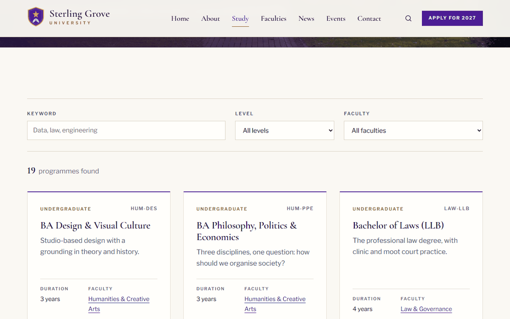
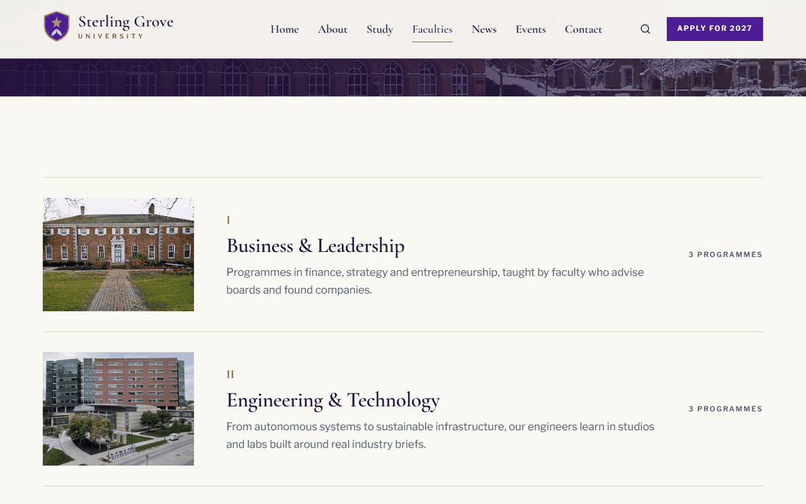
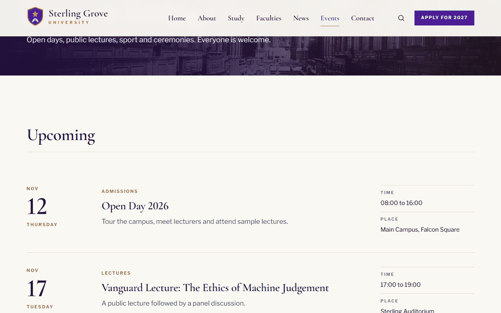
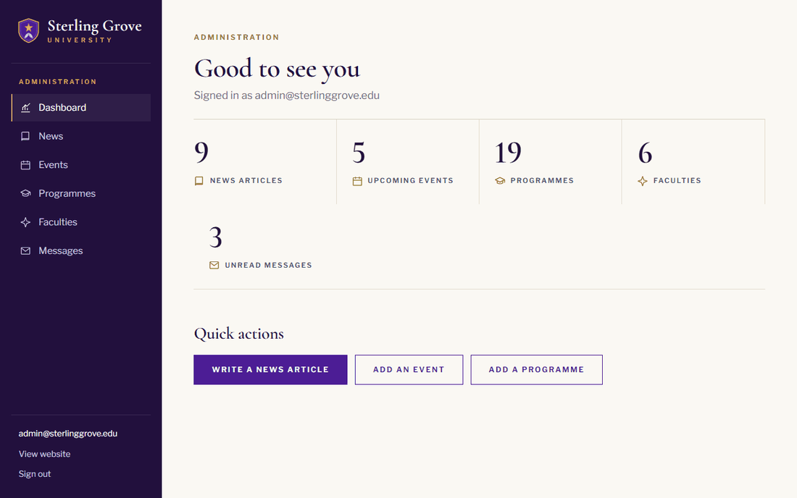
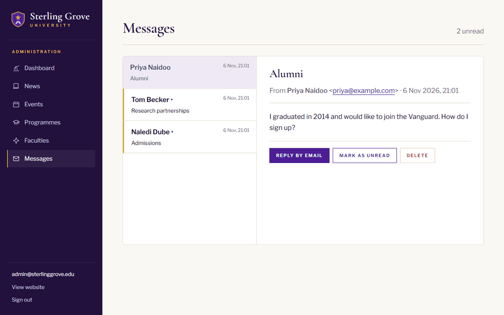
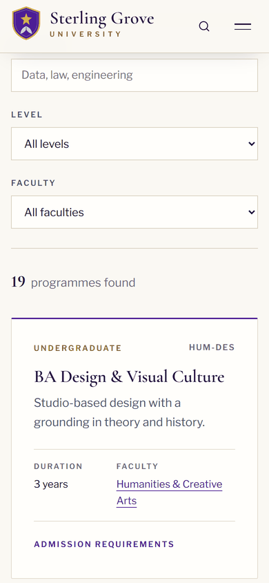

# Sterling Grove University

[](https://github.com/patricknyarukowa/sterling-grove-university/actions/workflows/ci.yml)

A full-stack university website with a staff admin area, built with Angular and ASP.NET Core.

**This is a personal portfolio project.** The university is fictional: it has no students, takes no applications and has no connection with any real institution. The photos show real buildings, listed in the [credits](#credits).


## What it does

- **Public website:** programme search with keyword, level and faculty filters, faculty pages, a news section with categories and paging, an events diary, and a contact form.
- **Admin area:** a dashboard, plus creating, editing and deleting news, events, programmes and faculties, and an inbox for contact form messages.

| | |
|---|---|
|  |  |
|  |  |
|  |  |

<p>
  
  
</p>

## Tech stack

| Layer    | Technology                                         | Folder                         |
|----------|----------------------------------------------------|--------------------------------|
| Frontend | Angular 22 (standalone components, signals, GSAP)  | `frontend/`                    |
| Backend  | ASP.NET Core 10 Web API (controllers)              | `backend/SterlingGrove.Api/`   |
| Database | SQL Server via Entity Framework Core 10            | database `SterlingGroveUniversity` |
| Auth     | ASP.NET Core Identity bearer tokens, `Admin` role  |                                |
| Tests    | xUnit (API), Vitest (website), GitHub Actions      | `backend/SterlingGrove.Api.Tests/`, `frontend/src/**/*.spec.ts` |

## Technical highlights

- **A test guards every endpoint.** It reads the attributes on all the controllers and fails if any write isn't admin-only, apart from the contact form, so a new endpoint can't quietly be left open. See `SecurityRulesTests.cs`.
- **Search lives in the URL.** The programme filters write to the query string, and the query string drives the search, so a search can be linked to, and coming back from a faculty page returns to the same results. See `pages/programmes.ts`.
- **Faculties can't lose their programmes.** The API refuses to delete a faculty that still has programmes, and a restricted foreign key backs that up in the database.
- **The site says when the API is down.** An HTTP interceptor notices failed connections and shows a banner, and failed calls can't crash a page. See `core/api-status.ts`.
- **The contact form is rate limited.** It's the only thing anyone can write to, so it takes 5 messages a minute per IP address. See `Program.cs`.
- **Two kinds of time.** A message's received time is stored in UTC and shown in the reader's time zone. Event times are campus clock times, so 08:00 reads as 08:00 wherever you're looking from.

## Run it

You need the [.NET 10 SDK](https://dotnet.microsoft.com/download), [Node.js 24](https://nodejs.org) and a SQL Server database. The API creates and fills the database on its first run.

**1. Database and API**, using either option:

<details open>
<summary><strong>Option A: Docker (macOS, Linux or Windows)</strong></summary>

Requires [Docker](https://www.docker.com/products/docker-desktop/). On Apple Silicon you may need to turn on Rosetta in Docker Desktop's settings, because SQL Server has no ARM image.

```bash
docker compose up -d --wait
cd backend/SterlingGrove.Api
dotnet run --launch-profile docker      # http://localhost:5097
```

</details>

<details>
<summary><strong>Option B: SQL Server Express (Windows)</strong></summary>

With a default `SQLEXPRESS` instance running:

```powershell
cd backend\SterlingGrove.Api
dotnet run --launch-profile http        # http://localhost:5097
```

</details>

**2. Website**, in a second terminal:

```bash
cd frontend
npm install                             # first time only
npm start                               # http://localhost:4200
```

Open http://localhost:4200. The dev server forwards `/api/...` to the API (see `frontend/proxy.conf.json`). The fonts load from Google Fonts, so without internet the site falls back to system fonts.

### Admin login

Go to http://localhost:4200/admin and sign in with:

| Email | Password |
|-------|----------|
| `admin@sterlinggrove.edu` | `Falcons!2026` |

This account only exists on your own machine. It comes from `appsettings.Development.json`, and public sign-up is switched off.

## Tests

```bash
dotnet test backend/SterlingGrove.Api.Tests   # API: every controller's rules, and who can call what
cd frontend && npm test                       # website: sign-in, route guard, API errors, form dates
```

The API tests use an in-memory SQLite database, so they don't need SQL Server. On every push, GitHub Actions runs both suites, builds the website, and starts the API against SQL Server in Docker.

## How the pieces fit together

```
Browser (Angular)  ──HTTP /api/...──▶  ASP.NET Core controllers  ──EF Core──▶  SQL Server
   pages/, admin/        JSON              Controllers/                Data/AppDbContext.cs
   core/api.service.ts                     Models/Entities.cs          (tables from Models)
```

### Where to look first

- `backend/SterlingGrove.Api/Models/Entities.cs`: every table
- `backend/SterlingGrove.Api/Controllers/NewsController.cs`: a complete CRUD controller with paging and search
- `backend/SterlingGrove.Api/Data/SeedData.cs`: sample content and the admin user
- `frontend/src/app/core/api.service.ts`: every HTTP call the site makes
- `frontend/src/app/admin/news-admin.ts`: a complete CRUD screen (list, form panel, delete)
- `frontend/src/styles.scss`: the colours (`--steel`, `--plum`, `--gold`) and shared styles

<details>
<summary><strong>API endpoints</strong></summary>

| Resource     | Read (anyone)                                 | Create / Update / Delete (Admin only)          |
|--------------|-----------------------------------------------|------------------------------------------------|
| Faculties    | `GET /api/faculties`, `GET /api/faculties/{slug}` | `POST`, `PUT /{id}`, `DELETE /{id}`        |
| Programmes   | `GET /api/programmes?q=&level=&facultyId=`, `GET /api/programmes/{id}` | `POST`, `PUT /{id}`, `DELETE /{id}` |
| News         | `GET /api/news?q=&category=&featured=&page=&pageSize=`, `GET /api/news/categories`, `GET /api/news/{slug}` | `POST`, `PUT /{id}`, `DELETE /{id}` |
| Events       | `GET /api/events?upcoming=&take=`, `GET /api/events/{id}` | `POST`, `PUT /{id}`, `DELETE /{id}` |
| Testimonials | `GET /api/testimonials`                       | `POST`, `PUT /{id}`, `DELETE /{id}` (API only, no admin screen) |
| Contact      | `POST /api/contact` (the public form)         | `GET` inbox, `PUT /{id}/read`, `DELETE /{id}`  |
| Auth         | `POST /api/auth/login`, `GET /api/auth/me`    | `GET /api/admin/stats`                         |

The API description is at http://localhost:5097/openapi/v1.json while running in Development.

</details>

## Changing the database

After editing a class in `Models/Entities.cs`:

```bash
cd backend/SterlingGrove.Api
dotnet ef migrations add DescribeYourChange -o Data/Migrations
dotnet run --launch-profile http        # migrations are applied on startup
```

To start again from scratch: `dotnet ef database drop`, then run the API again.

## Troubleshooting

- **"Can't reach the API"** across the top of the site: the API isn't running. Start it (step 1).
- **SQL connection errors:** on Windows, check the `SQL Server (SQLEXPRESS)` service is running, or edit `ConnectionStrings:Default` in `appsettings.json`. With Docker, check `docker compose ps` shows the container as healthy.
- **`docker compose up` says port 1433 is in use:** another SQL Server is running on your machine. Stop it, or change the port in both `docker-compose.yml` and the `docker` profile in `Properties/launchSettings.json`.
- **"That's a lot of messages in a short time":** you hit the contact form's limit of 5 messages a minute. Wait a minute.

## Not production ready, on purpose

This is built to be read and run locally, so a few things a real site would need are left out:

- Real applications: "Apply" leads to the programme search
- Email of any kind: contact messages only reach the admin inbox, and there are no password resets
- HTTPS and a hosting setup. The website relies on the dev server's proxy to reach the API.
- Privacy policy and terms
- Campus time zones: "upcoming" compares event times with UTC, so an event can stay listed for a couple of hours after it ends

## Credits

Photos are CC0, public domain or have no known restrictions, from Wikimedia Commons (full list with links in `frontend/public/images/CREDITS.txt`). The buildings belong to the real institutions named there. The fonts are Cormorant Garamond and Libre Franklin from Google Fonts (SIL Open Font License). GSAP is under its own free-to-use licence. The text, crest and icons are original.

## Licence

The code is under the [MIT Licence](LICENSE). The photos, fonts and third-party libraries keep their own licences, listed above.
